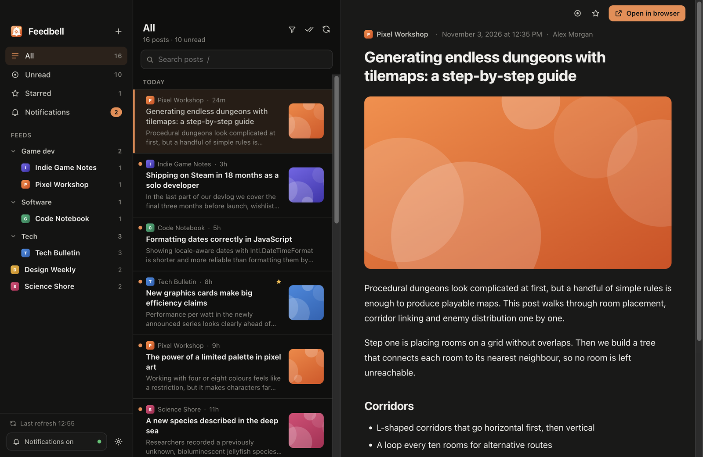
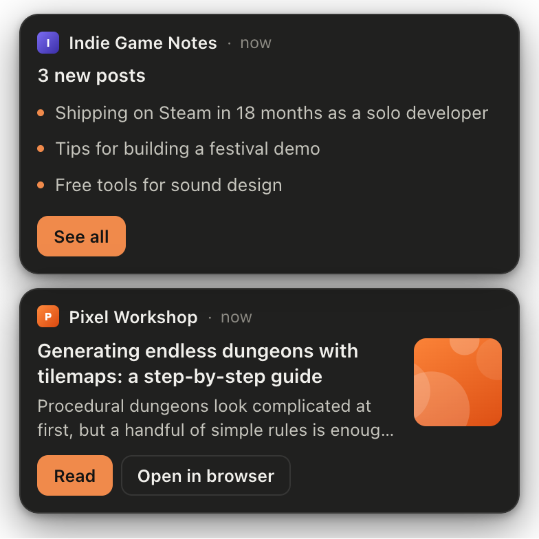
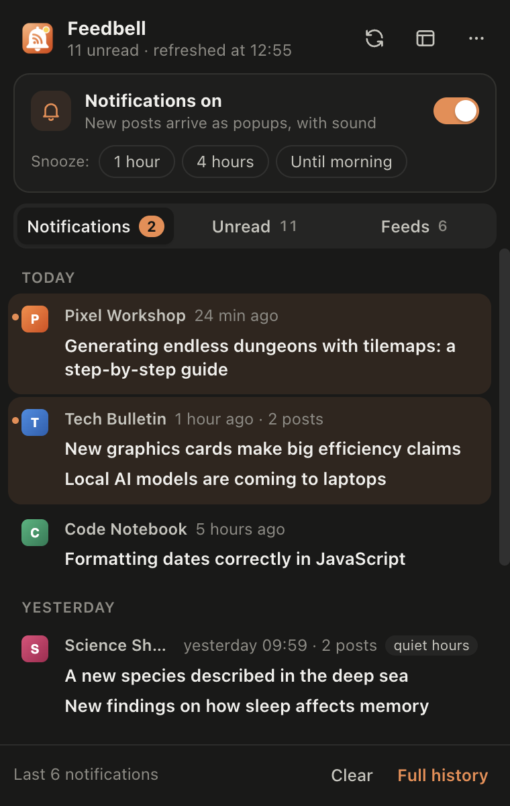
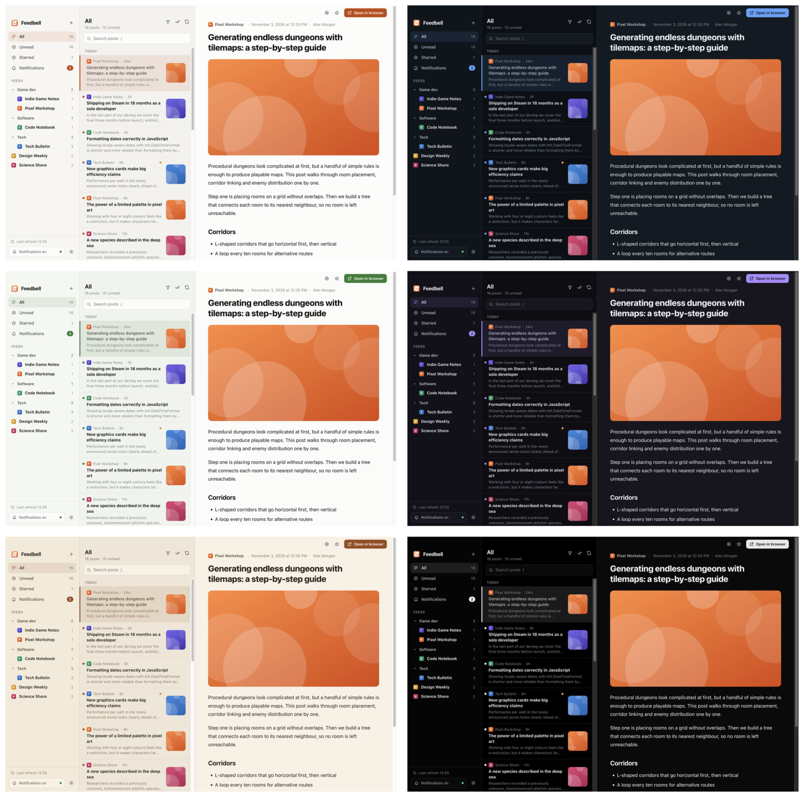
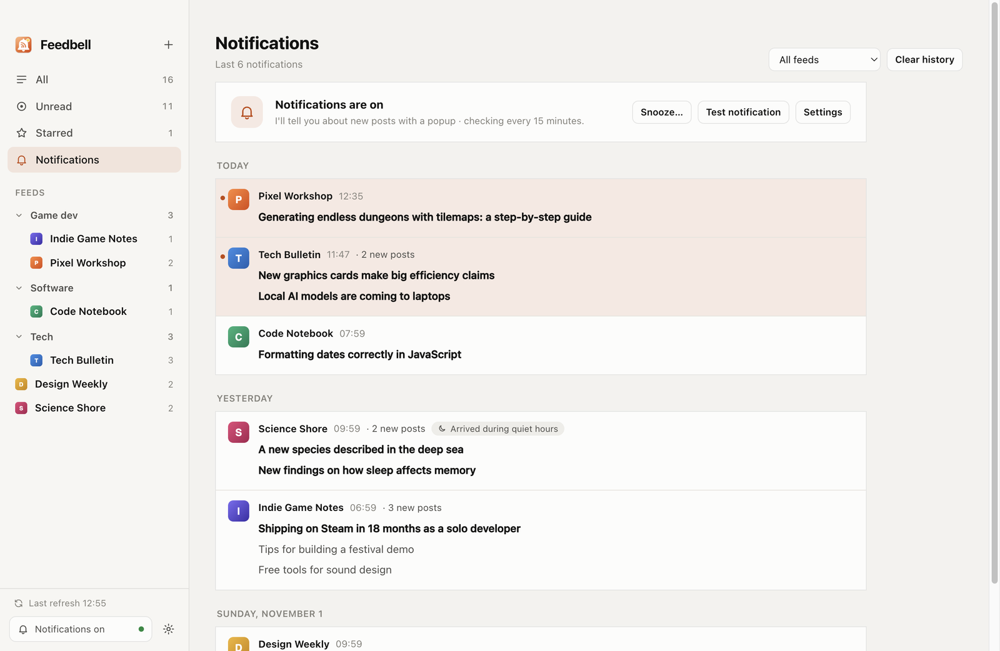
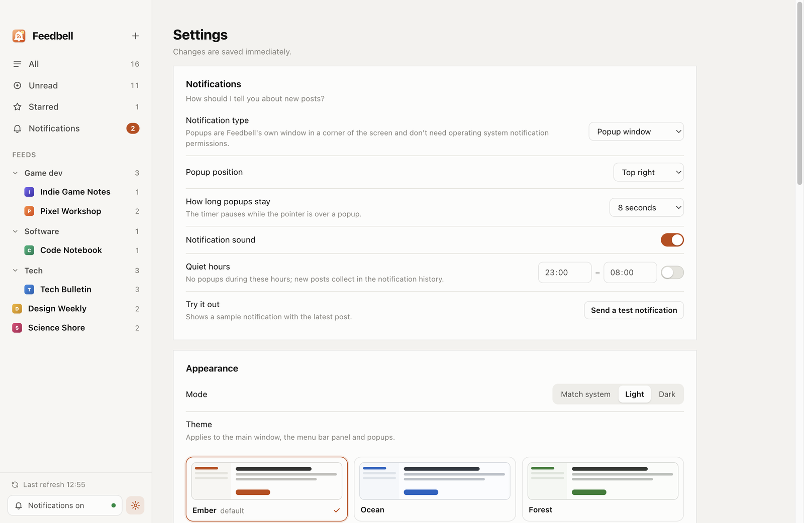

<p align="center">
  
</p>

<h1 align="center">Feedbell</h1>

<p align="center">
  A desktop RSS reader that tells you when something new is published.<br>
  macOS · Windows — your data never leaves your computer.
</p>

<p align="center">
  <b>English</b> · <a href="README.tr.md">Türkçe</a>
</p>

<p align="center"><sub>Previously called <i>Akış</i>. Upgrading? Your subscriptions, settings and history are copied over on first launch.</sub></p>



## Features

- **Reader** — three panes (feeds and folders · posts · article), search, unread filter, stars, keyboard navigation. Article content is sanitized: scripts, forms and tracking pixels are removed, and links open in your browser.
- **Notifications** — Feedbell checks your feeds in the background (every 15 minutes by default). When a post arrives, a popup slides in from a corner of the screen; posts from the same feed are grouped. Prefer system notifications? Use those, or both.
- **Notification history** — every notification is kept, grouped by day, including what arrived during quiet hours or while snoozed.
- **Menu bar panel** — click the menu bar (or system tray) icon for recent notifications, unread posts, per-feed notification switches and one-click snoozing.
- **Control over noise** — quiet hours, snooze (1 h, 4 h, until morning, until you turn it back on), per-feed mute and keyword filters ("only notify me about posts mentioning *godot*").
- **Finds feeds for you** — type a site address and Feedbell finds its feed. It also understands Reddit (`reddit.com/r/godot`) and GitHub repositories (follow releases, tags or commits).
- **Every feed format** — RSS 2.0, RSS 1.0 (RDF), Atom and JSON Feed, including broken XML and non-UTF-8 encodings.
- **Themes** — six color themes, each with light and dark variants, plus a serif or sans-serif reading font in four sizes.
- **Languages** — English and Turkish so far. [Add yours](CONTRIBUTING.md#translating-akış): it's a single JSON file.
- **OPML import/export**, open at login, unread count in the menu bar and Dock.

<table>
  <tr>
    <td width="50%" valign="top"><br><sub>Popup notifications — <b>Read</b> opens the post in Feedbell.</sub></td>
    <td width="50%" valign="top"><br><sub>Menu bar panel — notifications, unread posts and per-feed switches.</sub></td>
  </tr>
</table>

### Themes

Ember (default), Ocean, Forest, Lavender, Sepia and Graphite. Every theme follows your system's light or dark mode, or you can pin one in **Settings → Appearance** or the **View → Theme** menu.



### Notification history and settings





<sub>All screenshots use Feedbell's built-in demo data (`npm run demo`); the feeds in them are fictional.</sub>

## Install

Download the latest build from the [Releases](../../releases/latest) page:

| File | For |
|------|-----|
| `Feedbell-<version>-arm64.dmg` | Macs with Apple Silicon (M1 and later) |
| `Feedbell-<version>-x64.dmg` | Intel Macs |
| `Feedbell-<version>-x64.exe` | Windows 10 / 11 (64-bit) installer |

The builds aren't signed with an Apple Developer ID or a Windows code-signing certificate yet, so the first launch shows a warning:

- **macOS:** right-click Feedbell in Applications → **Open**, or System Settings → Privacy & Security → **Open Anyway**.
- **Windows:** in the SmartScreen dialog choose **More info → Run anyway**.

Or build it yourself:

```bash
npm install
npm run dist:mac      # or dist:win — installers end up in dist/
```

Linux: `npx electron-builder --linux` produces an AppImage. It should work (the tray falls back to a menu where clicks aren't supported), but it hasn't been tested yet — reports welcome.

## Using Feedbell

### Adding feeds

Press **+** (or `N` / `⌘N`) and type a site or feed address. If a page offers several different feeds, Feedbell asks which one you want; duplicate RSS/Atom copies and comment feeds are skipped automatically. Coming from another reader? **Settings → Import OPML** brings your subscriptions over with their folders.

Right-click a feed (or use `⋯`) to rename it, move it to a folder, turn its notifications off or limit them to keywords.

### Notifications

| Setting | What it does |
|---------|--------------|
| Notification type | Popup window (default — Feedbell's own window, no OS permission needed), system notification, both, or off (history only) |
| Popup position & duration | Any screen corner; 5–30 seconds or until closed. Hovering pauses the timer |
| Quiet hours | No popups during e.g. 23:00–08:00; posts still collect in the history |
| Snooze | From the bell in the sidebar, the menu bar panel or the **Notifications** menu |
| Per feed | Turn notifications off, or only notify when certain words appear |

New subscriptions and posts older than three days never produce notifications, so adding a feed doesn't flood your screen.

### Menu bar and running in the background

Closing the window keeps Feedbell running in the menu bar, so notifications keep coming. **Click** the icon for the notification panel, **right-click** it for a quick menu (refresh, recent notifications, snooze, quit). In the panel, `Esc` closes it, `1` `2` `3` switch tabs and `R` refreshes. To quit completely, right-click the icon → **Quit Feedbell**.

### Appearance and language

**Settings → Appearance** has the mode (match system / light / dark), color theme, reading font and text size. The language is set there too; with **System language**, Feedbell uses the first of your operating system's preferred languages that it supports.

### Keyboard shortcuts

| Key | |
|-----|---|
| `J` / `K` | Next / previous post |
| `Space` | Scroll down, then next post |
| `O` / `Enter` | Open in browser |
| `S` · `M` | Star · toggle read |
| `Shift` `A` | Mark everything in the list as read |
| `R` · `N` · `/` | Refresh · add feed · search |
| `⌘1`–`⌘4` | All · Unread · Starred · Notifications |

On Windows and Linux use `Ctrl` instead of `⌘`.

## Privacy and data

Feedbell has no account, no server and no analytics. It only connects to the feeds you subscribe to (and, once, to their sites to fetch an icon). Everything is stored as JSON on your computer:

- macOS: `~/Library/Application Support/Feedbell/data`
- Windows: `%APPDATA%\Feedbell\data`

**Settings → Subscriptions → Open data folder** takes you there.

## Contributing

Bug reports, translations and pull requests are welcome — see [CONTRIBUTING.md](CONTRIBUTING.md). Adding a language means translating one JSON file; `npm run i18n:check` lists anything missing.

```bash
npm install
npm run demo   # try it with sample data
npm test
```

## License

See [LICENSE](LICENSE).
