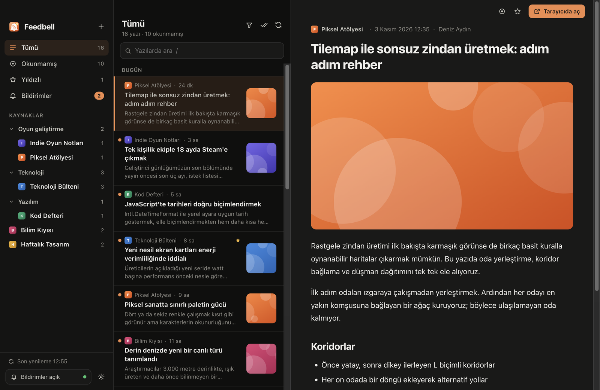
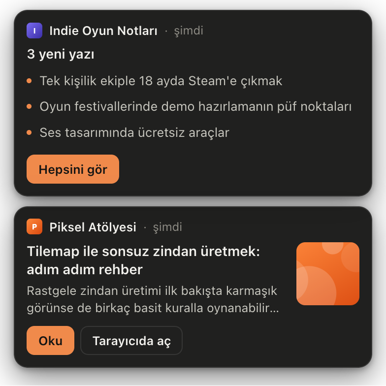
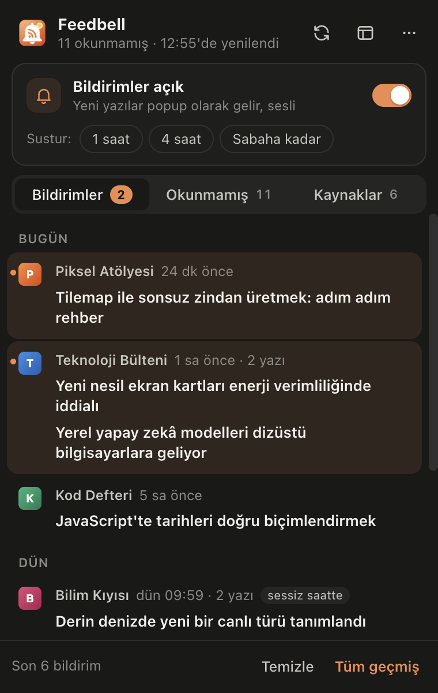
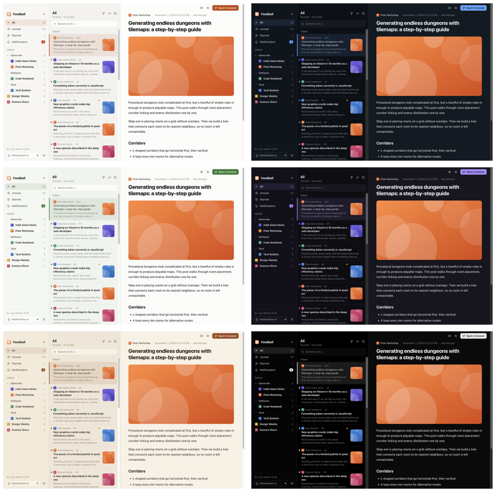
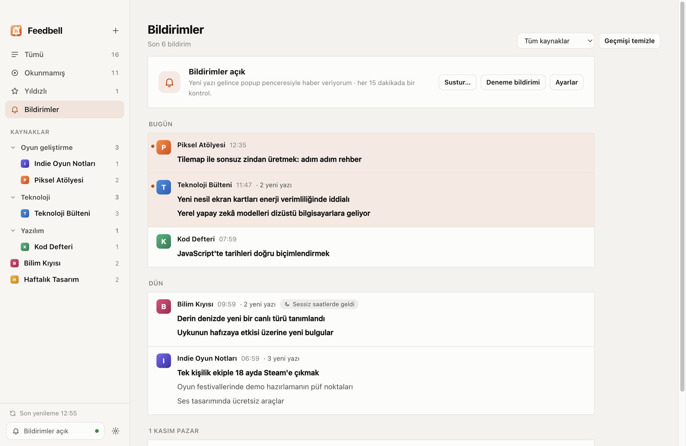

<p align="center">
  
</p>

<h1 align="center">Feedbell</h1>

<p align="center">
  Yeni bir yazı yayımlandığında haber veren masaüstü RSS okuyucusu.<br>
  macOS · Windows — verilerin bilgisayarından hiç çıkmaz.
</p>

<p align="center">
  <a href="README.md">English</a> · <b>Türkçe</b>
</p>

<p align="center"><sub>Önceki adı <i>Akış</i>'tı. Akış'tan geçiyorsan abonelikler, ayarlar ve geçmiş ilk açılışta kendiliğinden kopyalanır.</sub></p>



## Özellikler

- **Okuyucu:** üç bölme (kaynaklar ve klasörler · yazı listesi · okuma alanı), arama, okunmamış süzgeci, yıldızlar, klavyeyle gezinme. Yazı içeriği güvenli biçimde süzülür: betikler, formlar ve izleme pikselleri kaldırılır, bağlantılar tarayıcında açılır.
- **Bildirimler:** Feedbell kaynaklarını arka planda kontrol eder (varsayılan 15 dakikada bir). Yeni yazı gelince ekranın köşesinde bir popup çıkar; aynı kaynaktan gelenler tek kartta toplanır. İstersen sistem bildirimi ya da ikisi birden.
- **Bildirim geçmişi:** her bildirim gün gün saklanır; sessiz saatlerde ya da susturulmuşken gelenler ayrıca işaretlenir.
- **Menü çubuğu paneli:** menü çubuğundaki (Windows'ta sistem tepsisindeki) simgeye tıklayınca son bildirimler, okunmamışlar, kaynak başına bildirim anahtarları ve tek tıkla susturma.
- **Gürültü kontrolü:** sessiz saatler, susturma (1 saat, 4 saat, sabaha kadar, ben açana kadar), kaynak başına kapatma ve anahtar kelime süzgeci ("yalnızca *godot* geçen yazılarda bildir").
- **Beslemeyi kendisi bulur:** site adresi yazman yeterli. Reddit (`reddit.com/r/godot`) ve GitHub repolarını da tanır (yeni sürümleri, etiketleri ya da commitleri takip et).
- **Bütün besleme biçimleri:** RSS 2.0, RSS 1.0 (RDF), Atom ve JSON Feed; bozuk XML'ler, Türkçe sitelerdeki `windows-1254` / `ISO-8859-9` kodlamaları ve Türkçe tarih biçimleri dahil.
- **Temalar:** her biri açık ve koyu sürümlü altı renk teması; tırnaklı/tırnaksız okuma yazı tipi ve dört yazı boyutu.
- **Diller:** şimdilik Türkçe ve İngilizce. [Kendi dilini ekle](CONTRIBUTING.md#translating-akış): tek bir JSON dosyası.
- **OPML içe/dışa aktarma**, bilgisayar açılınca başlama, menü çubuğunda ve Dock'ta okunmamış sayısı.

<table>
  <tr>
    <td width="50%" valign="top"><br><sub>Popup bildirimleri: <b>Oku</b> yazıyı Feedbell'de açar.</sub></td>
    <td width="50%" valign="top"><br><sub>Menü çubuğu paneli: bildirimler, okunmamışlar ve kaynak anahtarları.</sub></td>
  </tr>
</table>

### Temalar

Kor (varsayılan), Okyanus, Orman, Lavanta, Sepya ve Grafit. Her tema sistemin açık/koyu moduna uyar; istersen birini sabitleyebilirsin. **Ayarlar → Görünüm** ya da **Görünüm → Tema** menüsü.



### Bildirim geçmişi



<sub>Bütün ekran görüntüleri Feedbell'in tanıtım verisiyle (`npm run demo`) alındı; içindeki kaynaklar kurgusal.</sub>

## Kurulum

En son sürümü [Releases](../../releases/latest) sayfasından indir:

| Dosya | Nerede çalışır |
|-------|----------------|
| `Feedbell-<sürüm>-arm64.dmg` | Apple Silicon Mac'ler (M1 ve sonrası) |
| `Feedbell-<sürüm>-x64.dmg` | Intel Mac'ler |
| `Feedbell-<sürüm>-x64.exe` | Windows 10 / 11 (64 bit) kurulum sihirbazı |

Sürümler henüz Apple geliştirici kimliğiyle ya da Windows kod imzalama sertifikasıyla imzalı değil; ilk açılışta uyarı çıkar:

- **macOS:** Uygulamalar'da Feedbell'e sağ tıklayıp **Aç**'ı seç (ya da Sistem Ayarları → Gizlilik ve Güvenlik → **Yine de aç**).
- **Windows:** SmartScreen penceresinde **Ek bilgi → Yine de çalıştır**.

Kendin derlemek için:

```bash
npm install
npm run dist:mac      # ya da dist:win — kurulum dosyaları dist/ klasörüne çıkar
```

Linux: `npx electron-builder --linux` bir AppImage üretir. Çalışması beklenir (tık desteklenmeyen masaüstlerinde tepsi simgesi menüye düşer) ama henüz denenmedi; geri bildirim memnuniyetle.

## Kullanım

### Kaynak eklemek

**+** düğmesine bas (ya da `N` / `⌘N`) ve bir adres yaz:

- **Besleme adresi** (`https://godotengine.org/rss.xml`) doğrudan eklenir.
- **Site adresi** (`godotengine.org`) yazarsan sayfadaki besleme bağlantısını bulur; bulamazsa `/feed`, `/rss`, `/atom.xml` gibi olağan yolları dener. Sayfada birden fazla farklı besleme varsa hangisini istediğini sorar; aynı beslemenin RSS/Atom kopyalarını ve yorum beslemelerini kendisi eler.
- **Reddit:** `reddit.com/r/godot` yazman yeterli.
- **GitHub reposu:** `github.com/godotengine/godot` yazınca *yeni sürümler*, *etiketler* ya da *commitler* arasından seçersin.
- Başka bir okuyucudan geliyorsan **Ayarlar → OPML içe aktar** ile aboneliklerini klasörleriyle birlikte taşı.

Bir kaynağa sağ tıklayınca (ya da `⋯`) adını, klasörünü, bildirimini ve bildirim anahtar kelimelerini değiştirebilir, aboneliği silebilirsin.

### Bildirimler

| Ayar | Ne yapar |
|------|----------|
| **Bildirim türü** | *Popup penceresi* (varsayılan; Feedbell'in kendi penceresi, işletim sistemi izni gerekmez), *Sistem bildirimi*, *İkisi birden* ya da *Kapalı* (yalnızca geçmişe yazar) |
| **Popup konumu ve süresi** | Ekranın herhangi bir köşesi; 5–30 saniye ya da *ben kapatana kadar*. Fare üzerindeyken süre durur |
| **Sessiz saatler** | Örneğin 23:00–08:00 arası popup çıkmaz; gelenler geçmişte birikir |
| **Sustur** | Kenar çubuğundaki zil düğmesinden, menü çubuğu panelinden ya da **Bildirimler** menüsünden |
| **Kaynak başına** | Bildirimi tamamen kapat ya da yalnızca belirli kelimeler geçince bildir (ör. Hacker News'te yalnızca `godot, blender`) |

Yeni eklenen bir kaynağın mevcut yazıları ve 3 günden eski yazılar bildirim üretmez; abonelik eklediğinde ekran popup'a boğulmaz.

### Menü çubuğu ve arka planda çalışma

Pencereyi kapatmak uygulamayı kapatmaz; Feedbell menü çubuğunda kalır ve bildirimler gelmeye devam eder. Simgeye **tıklamak** bildirim panelini, **sağ tıklamak** hızlı menüyü açar (yenile, son bildirimler, sustur, çıkış). Panelde `Esc` kapatır, `1` `2` `3` sekmeler arasında geçer, `R` yeniler. Tamamen kapatmak için simgeye sağ tıklayıp **Feedbell'den çık**'ı seç.

### Görünüm ve dil

**Ayarlar → Görünüm** bölümünde mod (sistemle aynı / açık / koyu), renk teması, okuma yazı tipi ve yazı boyutu seçilir. Dil de buradan değişir; **Sistem dili** seçiliyse Feedbell işletim sisteminin tercih ettiği dillerden ilk desteklenenini kullanır.

### Klavye kısayolları

| Tuş | |
|-----|---|
| `J` / `K` | Sonraki / önceki yazı |
| `Boşluk` | Aşağı kaydır, sonuna gelince sonraki yazı |
| `O` / `Enter` | Tarayıcıda aç |
| `S` · `M` | Yıldızla · okundu/okunmadı |
| `Shift` `A` | Listedekilerin tümünü okundu say |
| `R` · `N` · `/` | Yenile · kaynak ekle · ara |
| `⌘1`–`⌘4` | Tümü · Okunmamış · Yıldızlı · Bildirimler |

Windows ve Linux'ta `⌘` yerine `Ctrl`.

## Gizlilik ve veriler

Feedbell'de hesap, sunucu ya da analitik yok. Yalnızca abone olduğun beslemelere (ve simgesini almak için bir kez sitelerine) bağlanır. Her şey JSON dosyalarında, yalnızca bu bilgisayarda tutulur:

- macOS: `~/Library/Application Support/Feedbell/data`
- Windows: `%APPDATA%\Feedbell\data`

**Ayarlar → Abonelikler → Veri klasörünü aç** seni oraya götürür.

## Katkı

Hata bildirimleri, çeviriler ve pull request'ler memnuniyetle karşılanır; ayrıntılar [CONTRIBUTING.md](CONTRIBUTING.md)'de. Yeni bir dil eklemek tek bir JSON dosyasını çevirmek demek; `npm run i18n:check` eksikleri listeler.

```bash
npm install
npm run demo   # örnek veriyle dene
npm test
```

## Lisans

[LICENSE](LICENSE) dosyasına bak.
